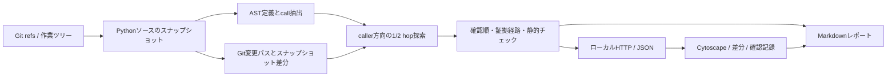

# 設計書 v1

## データフロー

## モジュールの責務

- analyzer.py: refのcommit解決、ソース収集、AST索引、差分、変更ノード、影響候補。
- review.py: 静的チェックと読む順番。LLMを使わず規則から候補を生成。
- report.py: CLI向けMarkdown出力。
- __main__.py: CLI、起動検証、標準HTTP、比較結果キャッシュ。
- app.js: 表示・検索・選択・depth切替、localStorage記録、ブラウザレポート。

## スナップショットと差分

git diff --name-only -zで追跡ファイルの変更パスを取得する。
同時に取り込んだBase / Headソースをdifflibで比較して、ASTと差分の入力を揃える。
未追跡や除外対象外のgitignoreファイルも作業ツリーのソース差分として扱う。
パスはdiffヘッダから切り出さず、NUL区切りとソース辞書のキーを使う。空白や日本語による誤判定を避ける。
改行形式はLFに正規化し、CRLFとLFだけの違いで定義を変更扱いしない。
読み取りのファイル間はOSによる原子的スナップショットではないため、解析中の大量編集は避けて再解析する。

snapshot_idはrepoパスとBase / Head全Pythonソース内容のハッシュ。
比較名だけではなく内容を識別し、作業ツリーの確認済み状態が編集後に残ることを防ぐ。
depth切替は保持中の結果から再計算する。対象を読み直すのは再解析または別の比較を選んだとき。
再解析に失敗した場合はキャッシュを破壊しない。

## 解析の保守性

解決候補は同一スコープ、同一モジュール、明示import、self/clsメソッド。
引数や代入先により名前が隠れている場合は未解決にする。型推論なしに任意のobj.methodを接続しない。
module名の重複や動的dispatchは未解決。未解決数はcall件数で、危険度の点数ではない。
構文エラーのファイルは警告と変更ファイル差分を表示し、Baseの定義を残せる場合はHead解析不可と表示する。
証拠経路は影響距離が1ずつ減るcall辺を辿るため、再帰や循環でも有限になる。

## 保存と安全性

ユーザーのrepoは読取専用。CLI export/reportは利用者が指定した出力先のみを書き込む。
ブラウザはリポジトリ由来の文字列をtextContentで描画する。
レビュー確認記録はブラウザ保存で、サーバーは変更を書き込むAPIを持たない。
配布ファイル更新では変更前の内容をバックアップする。対象repoで任意のテスト・ビルド・コードを自動実行しない。

## 拡張点

将来のAIレビューは今回のgraph/reviewデータを入力にできる。
追加する場合はreview engineの識別、モデル情報、根拠、提案と事実の区別、送信範囲をAPI仕様に追加する。
ホスティングや共有サーバー化には認証、アクセス制御、repo境界、保存管理が必要になるため、現サーバーをそのまま外部公開しない。
