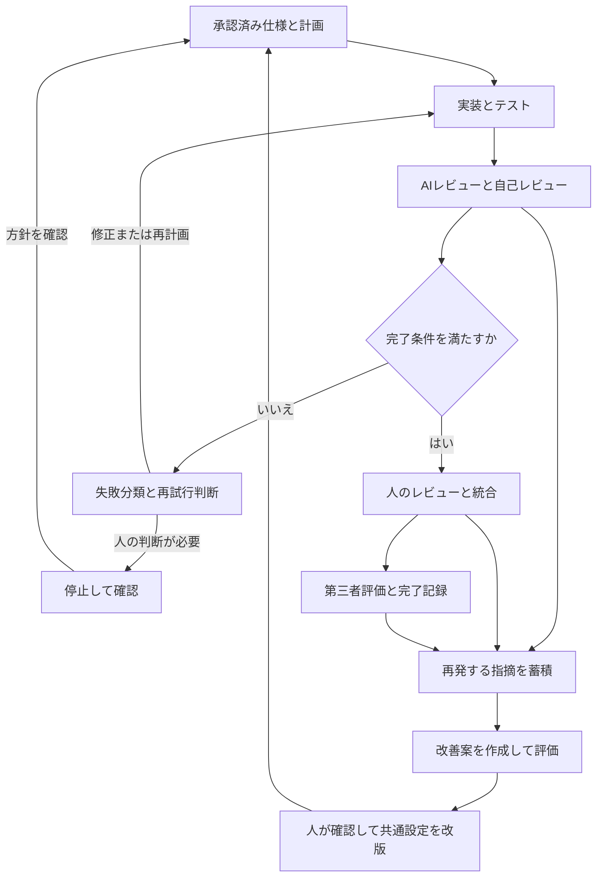
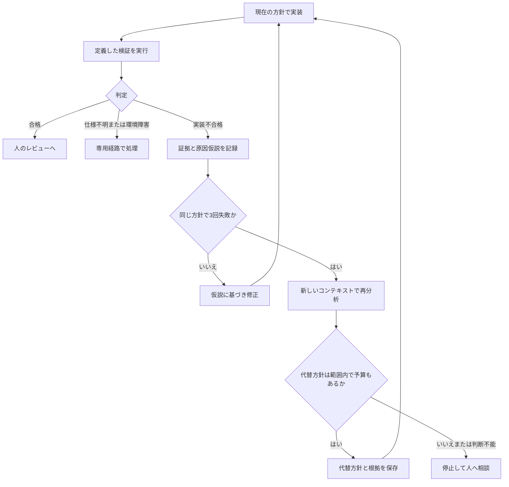
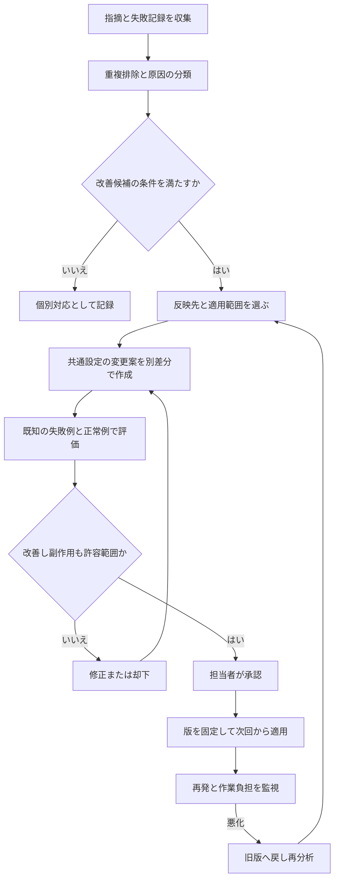

# Kiroによる開発自動化・再試行・改善の運用設計

作成日：2026-10-27  
状態：導入用のたたき台／未実装・未検証

## 1. 目的と適用範囲

仕様検討から第三者評価までの開発工程について、Kiroで自動化する範囲、人が判断する境界、保存する成果物を定義する。特に次の二つを別々に管理する。

- **作業中の改善**：実装→検証→修正を繰り返し、解決しなければ実装方針を再検討する。
- **手順の改善**：繰り返す指摘を分析し、元の指示・Steering・テスト・実行環境を改善する。

「3回失敗」「同種指摘3件」などの閾値は、本資料で提案する初期値。Kiroの既定値や業界標準ではない。社内規程、作業規模、利用上限に合わせて調整する。

本資料は運用設計書であり、そのまま実行できるKiro Workflow設定ではない。実環境のバージョン・権限・ツールに合わせて定義を生成・検証する。既存手順書を上書きしない独立した資料として作成した。

## 2. 全体像：開発と改善を二つの経路で回す



同じ作業を直すループと、次回以降の作業手順を改善するループを混ぜない。実装担当が合格条件や共通設定を都合よく変更して検証を通すことを避ける。

## 3. Kiroの仕組みへの割り当て

| 要素 | 役割 | 本資料での使い方 |
|---|---|---|
| Steering | 継続的に参照する知識・規約 | 正式仕様への参照、共通の判断規則、設計上の制約 |
| Custom agents | 担当ごとの指示・ツール・権限 | 調査・実装・レビュー・改善案作成の役割分担 |
| Workflow | 手順と引き継ぎ・反復の制御 | 実装、検証、分類、再計画、結果整理を接続 |
| Hooks | イベントをきっかけに処理を実行 | 変更後のlint等。重い検証はWorkflowの明示ステップで実行 |
| テスト・CI・検証スクリプト | 実行可能な合否判定 | 必須チェック、対象SHA、結果と証跡を記録 |
| 権限設定 | 実行可能な操作を制御 | 読み取り担当の編集禁止、対象外操作の制限 |
| Jira／PR／文書管理 | 正式な進捗と承認 | 承認者・対象版・指摘・対応・証跡を追跡 |

指示文の「禁止」は技術的なアクセス制御の代わりにならない。必要な制約は権限、変更差分チェック、CI等にも反映する。

各工程は会話履歴を共有する前提にしない。次工程へ渡すファイル・仕様の版・対象SHA・未決事項を明示する。

## 4. 自動化する工程と承認境界

| 工程 | 自動実行する内容 | 人の判断・承認 | 保存する主なもの |
|---|---|---|---|
| 仕様検討・要件定義 | 論点抽出、案作成、矛盾検出 | 業務要求、対象範囲、優先順位 | 要件、受入条件、未決事項 |
| 変更仕様・機能仕様 | 下書き、既存仕様とコードの照合 | 仕様の決定・正式承認 | 正本の版、変更点、承認記録 |
| Jira準備 | 本文・作業分割・依存関係の案 | 分担、完了条件、登録・更新の扱い | チケットと仕様・PRへのリンク |
| テスト設計・実装計画 | ケース案、関連コード調査、計画作成 | 期待結果、設計・変更範囲 | テスト設計、承認済み計画 |
| 実装・検証 | コードとテスト作成、実行、AIレビュー、修正 | 自己レビュー、未決の業務判断 | 差分、検証結果、レビュー記録 |
| 検証環境デプロイ | 承認された手順で配置・確認 | 実行権限、環境の使用調整 | SHA／ビルドID、環境、結果 |
| コードレビュー対応 | 指摘分類、修正案、再検証 | 指摘採否、仕様変更、正式レビュー | 指摘と対応コミット、再承認 |
| マージ・競合解消 | 最新差分調査、解消案、再検証 | マージ順、競合の意図、マージ承認 | 解消差分、対象SHA、統合結果 |
| 第三者評価 | 承認済み項目からスクリプト案と結果整理 | 期待結果の独立確認、合否判断 | スクリプト、データ、評価証跡 |
| 共通手順の改善 | 再発分析、設定の差分案、評価 | 共通ルールの採用と適用範囲 | 改善提案、評価結果、承認版 |

Jira・PR・配置先への操作は、既存のCLIや接続と権限を用意して初めて実行できる。Kiroを導入しただけで外部操作が自動的に可能になるとは扱わない。

## 5. 実装ループ：3回失敗したらどうするか

### 5.1 失敗回数の数え方

**1試行＝同じ実装方針のもとで変更を行い、定義した検証一式を実行して判定する単位。**

テストケースが10件失敗しても、その実行を10試行とは数えない。テスト失敗・再現可能な動作不良・根拠のある必須レビュー指摘が残れば、その試行は不合格とする。重複指摘や根拠のない提案は分類・確認してから扱う。

| 変数 | 初期値／上限案 | 意味 |
|---|---|---|
| attempt_in_strategy | 1〜3 | 現在の方針での試行数。最初の実装も1回に含む |
| strategy_count | 最大2 | 最初の方針＋代替方針1つ |
| total_attempts | 最大6 | 方針変更後もリセットしない累計試行数 |
| environment_retries | 同一障害で最大2回 | 許可された一時的環境エラーの追加再実行回数 |
| elapsed／cost | 起動前に設定 | 時間・費用の上限。到達したら途中でも停止 |

方針を変更しても総予算は増やさない。上限の自動引き上げは行わない。

### 5.2 再試行のフロー



### 5.3 3回目の失敗後に行うこと

1. いったん編集を止め、差分・ログ・検証条件を保存する。
2. 当初の仕様・計画・失敗記録を、新しい分析コンテキストに渡す。
3. 再現条件、破綻した仮定、試した方法、失敗理由を整理する。
4. 代替方針を作り、元の方針との違い・根拠・影響範囲を示す。
5. 承認済み範囲と受入条件を維持できる場合だけ、残予算内で切り替える。
6. 方針の正しさを判断できない、仕様・API・データ構造等の変更が必要、または累計上限到達なら人へ戻す。

**3回失敗は「必ず別実装にする」命令ではなく、同じ方法を続けず再診断する分岐。** 原因が環境や誤ったテストなら、無理に実装方針を変えない。

### 5.4 方針転換の例

| 状況 | 再診断・方針転換の例 | 人に戻す条件 |
|---|---|---|
| 条件分岐追加で別ケースが壊れる | 不変条件を整理し、状態遷移や既存共通処理の利用を比較 | 外部から見える動作の変更が必要 |
| E2Eが何度もタイムアウト | ログと画面状態から原因を切り分け、待機条件やデータを検証 | 環境設定や実行権限の変更が必要 |
| 既存の共通サービスを使わず再実装する | 呼び出し元・利用例を調査し、共通サービス経由の案を作る | 共通サービスの変更が必要 |
| テストは通るが仕様と違う | 仕様と期待結果を照合し、欠けたケースを追加 | 期待結果自体が未確定 |

## 6. 失敗分類と停止条件

| 分類 | 例 | 自動対応 | 回数の扱い |
|---|---|---|---|
| 実装不備 | ロジック不良、回帰、必須レビュー指摘 | 原因仮説→修正→再検証 | 実装試行数に算入 |
| 一時的環境障害 | 一時的接続切れ、テスト環境の起動待ち | 許可済みの同じ操作を最大2回追加実行 | 環境枠で記録、時間・費用は総予算に算入 |
| 恒常的環境障害 | 権限不足、依存サービス停止 | 証拠を保存して停止 | 実装の失敗と混同しない |
| 仕様不足・矛盾 | 資料間の不一致、業務ルール未定 | 質問と影響を整理して停止 | 推測による修正ループを開始しない |
| テスト側の問題 | fixture不整合、期待結果の誤りの疑い | 証拠と修正案を作成 | 期待結果・受入条件の変更は確認待ち |
| 誤検知・任意改善 | 根拠のない指摘、好みの変更 | 採否と理由を記録 | 確定前に失敗カウントへ入れない |

各修正は「前回と何が違い、その変更でなぜ解決すると考えるか」を記録する。同じ変更の往復や、待ち時間を増やすだけの再試行は進展と扱わない。

## 7. 繰り返す指摘を元の指示へ戻す

### 7.1 改善候補にする条件

| 条件（初期案） | 対応 |
|---|---|
| 同一作業で同じ原因の指摘が修正後に再発 | 入力不足・読み込み漏れ・検証不足を調べ、作業固有の指示を補う |
| 別のPR／チケットで同じ原因の指摘が3件 | 共通設定の改善候補として登録する |
| 重大な不具合・権限不備が1件 | 件数を待たず、人が優先度と予防策を判断する |
| 表現だけ似ているが原因が違う | 同じ再発件数にまとめない |
| 既存ルールはあるが参照されていない | 文言追加より、読み込み・引き継ぎ方法を修正する |

同じ指摘を複数のAIが出しただけでは、複数件の再発と数えない。原因キー、対象チケット、修正後に再発したかを記録する。

### 7.2 改善のフロー



改善案は作業中に作成してよいが、共通設定の有効化は分ける。実装担当が共有プロンプトを無制限に自己改変する運用にはしない。

### 7.3 「元のプロンプト」のどこを直すか

| 原因 | 主な反映先 | 修正例 |
|---|---|---|
| 今回の依頼の前提が抜けていた | チケット・作業固有の入力 | 対象ユーザー、例外、変更しない範囲を補う |
| 仕様が間違っていた | 正式仕様と承認 | 元の業務仕様を確認・改版する |
| 全体の実装規約を見落とす | Steering／担当agentの参照設定 | 短いルールに根拠と既存実装へのリンクを付ける |
| レビュー時に同じ観点が抜ける | reviewerの指示 | 確認対象、違反例、根拠の出し方を明記する |
| 工程が飛ばされる | Workflow | 必須の検証ステップと完了条件を追加する |
| 機械的に判定できる違反 | lint・テスト・CI | 禁止API、型、回帰条件を自動検出する |
| 必要な資料が読み込まれない | 入力組み立て・handoff | 参照ファイルと版を引き渡し、存在と読み込みを確認する |
| 必要な検証が実行できない | 実行環境・スクリプト | 依存関係、テストデータ、起動手順を整える |

注意文を増やす前に、実際にそのルールが読み込まれたか、他のルールと矛盾していないか、実行可能かを確認する。

### 7.4 改善例（架空）

指摘：「更新時に監査ログが記録されていない」が、別の変更で繰り返された。

| 改善先 | 内容 |
|---|---|
| Steering | 適用対象の更新では共通サービスAを使う。理由・例外・関連実装を記載 |
| 実装計画 | 対象処理がルールの適用範囲か、計画時に確認 |
| reviewer指示 | 更新結果に加えて監査ログの処理とテストを確認 |
| 自動テスト | 対象の更新操作で監査ログが残ることを検証 |
| 評価用ケース | 必要なケースと例外ケースの両方を用意 |

「今後は注意する」だけで終わらず、原因に合った検知・予防へつなぐ。

## 8. 改善の評価とロールバック

プロンプトを修正したという事実と、出力が改善したという結果を区別する。

1. 過去に失敗した代表ケースを、機密情報の扱いを確認したうえで再現可能にする。
2. 違反に見えるが正しい例外ケース、通常の正常ケースも含める。
3. 同じ入力・コード基点・モデル条件で旧版と新版を比較する。
4. 自動テストの結果、必須指摘、誤検知、手戻り、時間・費用を記録する。
5. AIの出力には変動があるため、重要な変更は一度の成功だけで判断しない。
6. 採用後も再発・誤検知・総負担を確認し、悪化時は旧版に戻す。

| 指標 | 見る理由 |
|---|---|
| 同種指摘の再発件数／対象作業数 | 作業量の増減と分けて再発を確認する |
| 誤検知と例外の誤適用 | ルールを強めた副作用を確認する |
| 人の誘導・修正時間 | 指示の複雑化で負担が増えていないか |
| 必須テストと回帰テストの結果 | 見た目の改善による機能退行を防ぐ |
| 完了までの時間と費用 | 追加レビューやループの採算を確認する |

合格基準・受入条件を下げて改善扱いにしない。共有ルールの改版はPR等で別に管理し、旧版と承認記録を保持する。

## 9. 保存するものとフォルダ案

以下は提案名であり、Kiroが自動生成する標準構成ではない。既存の保存先がある場合はリンクで接続し、重複管理を避ける。

| 区分 | 保存先の例 | 内容 |
|---|---|---|
| 正式仕様・承認 | 社内文書管理／Jira | 正本、版、承認者、承認対象 |
| 共通知識 | .kiro/steering/ | 短い規約、適用範囲、根拠と参照先 |
| agent設定 | .kiro/agents/ | 担当の指示・ツール・権限 |
| Workflow定義 | .kiro/workflows/ | 順序、入力、handoff、repeat、停止条件 |
| 索引 | docs/changes/CHANGE-ID/index.md | Jira、仕様、PR、検証証跡へのリンク |
| 実装計画 | docs/changes/CHANGE-ID/plan.md | 方法、対象外、根拠、承認した版 |
| 判断記録 | docs/changes/CHANGE-ID/decisions.md | 疑問、回答、理由、確認者 |
| 試行履歴 | 指定の実行記録先／attempts.jsonl | 試行番号、方針ID、原因仮説、結果 |
| 実行状態 | 指定の実行記録先／run-state.json | 現在段階、累計回数、使用予算、停止理由 |
| 検証・レビュー | CI等／validation.json、review.md | 対象SHA、指摘ID、実行結果、ログURL |
| 改善案 | docs/ai-improvements/IMPROVEMENT-ID.md | 再発根拠、変更案、評価、採否 |
| 評価ケース | tests/ai-workflow-evals/等 | 共通設定の改善を比較する入力と合否基準 |

再開時に累計回数や予算を失わないよう、会話の記憶だけに依存しない。成功した工程をむやみに最初から実行しない。デプロイやJira登録等の外部操作には実行済み識別子を残し、再開時の重複実行を防ぐ。

## 10. 状態と失敗記録の例

次のJSONは運用データの設計例。Kiroの設定スキーマではない。

```json
{
  "change_id": "CHANGE-123",
  "run_id": "run-001",
  "status": "REPLAN_REQUIRED",
  "spec_revision": "rev-4",
  "plan_revision": "plan-1",
  "base_commit": "<actual-base-sha>",
  "tested_commit": "<actual-tested-sha>",
  "strategy_id": "strategy-1",
  "strategy_count": 1,
  "attempt_in_strategy": 3,
  "total_attempts": 3,
  "limits": {
    "attempts_per_strategy": 3,
    "max_strategies": 2,
    "max_total_attempts": 6
  },
  "blocking_findings": ["F-007"],
  "next_action": "Analyze failures before further edits"
}
```

実装回数・総時間・費用上限は、エージェントの自己申告だけでなく、可能な範囲でWorkflow制御や実行側の記録と照合する。上記の限度以外に、実際の時間・費用・環境再実行の上限も起動時に指定する。

### 試行記録の必須項目

| 項目 | 内容 |
|---|---|
| 識別情報 | チケットID、run ID、方針ID、試行番号 |
| 入力 | 仕様・計画・指示設定の版、基点 |
| 仮説 | 何が原因で、何を変えれば直ると考えたか |
| 差分 | 今回変更した箇所、コミットまたは差分識別子 |
| 検証 | コマンド、日時、環境、結果、対象SHA |
| 指摘 | 原因キー、重要度、根拠、採否・対応 |
| 次の動作 | 継続、再計画、確認待ち、完了と理由 |

コミットしていない変更を検証した場合は、SHAだけでは不十分なため、差分識別子や成果物のハッシュも残す。

## 11. 担当agentと権限の初期案

| 役割 | 入力 | 出力 | 制約 |
|---|---|---|---|
| planner | 仕様、コード、既存ルール | 計画、疑問、根拠 | 実装を変更しない |
| implementer | 承認済み計画、仕様、テスト設計 | コード、テスト、変更概要 | 仕様・共通ルール・受入条件を独断で変更しない |
| verifier | 差分、定義済みコマンド | 検証結果と証跡 | 実行不能を成功と扱わない |
| reviewer | 仕様、差分、テスト結果 | 根拠付き指摘、重要度、判定 | 原則読み取り。指摘だけで正式承認を代替しない |
| replanner | 失敗履歴、仕様、差分 | 原因分析、代替方針、影響 | 失敗した案の前提を再確認する |
| improvement proposer | 再発記録、共通設定 | 改善PR案と評価計画 | 共有設定を直接有効化しない |

これらは役割案。同じagentを再利用してもよく、すべてを常時起動する必要はない。実装とレビューの独立性は、コンテキストを分けるだけで保証されないため、合否をテストと根拠で確認する。

## 12. Kiroで組み立てる手順

### 12.1 初回準備

1. KiroのIDE／CLIのバージョンとWorkflowの利用可否を確認する。
2. 正式仕様、承認、コード、テスト、証跡の保存先を決める。
3. 必須チェックをKiroから実行できる状態にする。
4. 本書を入力として、Workflow定義と必要なagent設定を生成させる。
5. 入力・handoff・再試行・停止条件・権限・保存先を人が確認する。
6. 保存した定義をKiroのvalidate_workflowで検証する。
7. 小さな変更で、正常終了・失敗・再計画・停止・再開を確認する。

公式ではWorkflow recipeを .kiro/workflows/ 配下の *.workflow.json／*.workflow.yaml／*.workflow.yml として保存できる。利用できる機能はクライアントとアカウントの状態による。

### 12.2 構築時にKiroへ指定する要点

```text
この運用設計書からWorkflowとagent設定の案を作成する。
まず「承認済み計画からの実装・検証」を対象にする。

同一方針は最大3試行、方針は最大2つ、累計最大6試行。
3回失敗時は編集を止め、別コンテキストで再診断する。
方針変更は承認済み範囲内に限り、根拠と差分を保存する。
仕様不足、範囲拡大、上限到達では停止して人へ戻す。

テスト失敗・レビュー指摘・環境障害を分類する。
会話再開時も累計回数を保持する。
各工程の入力・出力・合否・対象SHAを成果物で引き渡す。

繰り返す指摘は改善候補へ集約する。
共有Steering、agentの指示、Workflow、受入条件を
実装中に独断で書き換えて合格扱いにしない。
共通設定の改善は別差分・評価・承認の経路を通す。

まず定義を作成しvalidate_workflowで検証する。
制御として実装できていない条件を一覧にし、まだ起動しない。
```

この文章を貼るだけで運用が完成するわけではない。Workflowの反復上限、指摘の分類、検証結果の判定、権限などに条件が実装されているかを確認する。

### 12.3 機能が足りない場合

Workflowに必要な承認待ちや状態管理をその環境で実装できない場合は、工程を別のWorkflowに分割する。必要なら外側のスクリプト／CIで回数・結果・承認を管理し、Kiro CLIに限定した作業を依頼する。存在を確認していない設定キーやコマンドで代替しない。

## 13. 導入時の動作確認

| 確認ケース | 期待する動作 |
|---|---|
| 1回目で合格 | 証跡を保存して人のレビューへ |
| 1〜2回の修正で合格 | 試行履歴を保持し、余分なループを実行しない |
| 最初の方針で3回失敗 | 自動編集を止め、再診断して代替方針または相談へ |
| 代替方針でも3回失敗 | 累計6回で停止し、証拠と未解決事項を報告 |
| 業務仕様が不明 | 回数上限を待たず確認待ちへ |
| テスト環境が停止 | コードを無意味に修正せず、環境障害として記録 |
| 会話・クライアントを再開 | 回数と対象版を復元し、承認済み外部操作を重複実行しない |
| 同種指摘が別PRで3件 | 共通設定の改善候補を作成し、直接有効化しない |
| 新ルールで例外ケースが壊れる | 改善案を修正・却下し、採用後なら旧版へ戻す |
| テスト未実行・結果不明 | 完了扱いにせず、理由と残件を報告 |

本資料自体はこれらの動作を実行・検証した結果ではない。導入完了には実環境での確認が必要。

## 14. 公式資料と、本資料独自の提案の区別

参照日：2026-10-27。公式資料は機能の対応付けに使用。再試行回数・再発件数・承認境界は本資料の運用提案であり、公式推奨値ではない。

- [Kiro：Author workflows](https://kiro.dev/docs/workflows/authoring/) — recipeの保存、工程、成果物の引き渡し、反復など。
- [Kiro：Steering](https://kiro.dev/docs/steering/) — 継続的なプロジェクト知識の提供。
- [Kiro：Hooks](https://kiro.dev/docs/hooks/) — イベントに応じたコマンド・指示の実行。
- [Kiro：Workflows](https://kiro.dev/docs/workflows/) — 有効化、実行、監視の概要。

本文のファイル名・役割名・状態名・JSONは設計例で、Kiroの標準生成物や正式な設定スキーマではない。

